# SIPUS-Del: Sistem Informasi Perpustakaan Kampus Del

Tugas Mandiri Minggu 5, **12S3101 Pemrograman & Pengujian Web**, Institut Teknologi Del (Ganjil 2026/2027).

| | |
|---|---|
| **Nama** | Artha Liebe Siregar |
| **NIM** | 12S24010 |
| **GitHub** | [@Arthasiregar](https://github.com/Arthasiregar) |
| **Repositori** | `ppw-2026-week5-12S24010` |
| **Framework** | Laravel 11.x (PHP 8.4, SQLite) |

SIPUS-Del adalah aplikasi web perpustakaan kampus berbasis **server-side rendering** dengan arsitektur **Model-View-Controller (MVC)**. Aplikasi ini mengelola data **Buku** dan **Kategori** (relasi One-to-Many) lengkap dengan validasi server-side, proteksi CSRF, pagination, dan audit kueri SQL untuk membuktikan bahwa N+1 Query Problem sudah teratasi dengan Eager Loading.

## Daftar Isi

1. [Fitur](#1-fitur)
2. [Kebutuhan Sistem](#2-kebutuhan-sistem)
3. [Cara Instalasi](#3-cara-instalasi)
4. [Arsitektur MVC dan Routing RESTful](#4-arsitektur-mvc-dan-routing-restful)
5. [Model Relasional dan Eloquent ORM](#5-model-relasional-dan-eloquent-orm)
6. [Validasi Input dan Keamanan Web](#6-validasi-input-dan-keamanan-web)
7. [Blade Templating dan Desain UI](#7-blade-templating-dan-desain-ui)
8. [Seeder, Factory, dan Audit Kueri SQL](#8-seeder-factory-dan-audit-kueri-sql)
9. [Riwayat Git](#9-riwayat-git)
10. [Kesesuaian dengan Spesifikasi Tugas](#10-kesesuaian-dengan-spesifikasi-tugas)
11. [Catatan Teknis](#11-catatan-teknis)

---

## 1. Fitur

- CRUD **Buku** dan **Kategori** melalui `Route::resource` (7 aksi RESTful per entitas) dengan Implicit Route Model Binding.
- Relasi Eloquent `Kategori hasMany Buku` dan `Buku belongsTo Kategori`, dengan proteksi mass assignment (`$fillable`).
- Eager Loading `Buku::with('kategori')` pada halaman daftar buku untuk mencegah N+1 Query.
- Hitung jumlah buku per kategori dengan `withCount('bukus')` (satu kueri, tanpa N+1).
- Validasi server-side `$request->validate()`: ISBN unik, judul minimal 5 karakter, stok minimal 0, dan aturan lainnya.
- Proteksi CSRF (`@csrf`), method spoofing (`@method('PUT')` / `@method('DELETE')`), dan escape output otomatis Blade (`{{ }}`) terhadap XSS.
- Master layout Blade Component `<x-layout>` bertema **Del Royal Purple (#4C1D95)**, pagination Bootstrap 5, flash message (sukses dan galat), dan `@forelse` untuk data kosong.
- Kategori yang masih memiliki buku **tidak dapat dihapus** (dijaga di controller dan di level database).
- Seeder dan Factory (Faker `id_ID`): 5 kategori dan 20 buku.
- Listener `DB::listen` yang mencatat seluruh kueri SQL ke `storage/logs/laravel.log`.

## 2. Kebutuhan Sistem

| Perangkat | Versi |
|---|---|
| PHP | 8.2 atau lebih baru (diuji pada 8.4.26) |
| Ekstensi PHP | `pdo_sqlite`, `sqlite3`, `mbstring`, `openssl`, `curl`, `fileinfo`, `zip` |
| Composer | 2.6 atau lebih baru (diuji pada 2.10.3) |
| Database | SQLite (bawaan Laravel 11, tidak perlu instalasi server database) |
| Koneksi internet | Untuk memuat Bootstrap 5 dari CDN |

## 3. Cara Instalasi

```bash
# 1. Clone repositori
git clone https://github.com/Arthasiregar/ppw-2026-week5-12S24010.git
cd ppw-2026-week5-12S24010

# 2. Pasang dependensi PHP
composer install

# 3. Siapkan berkas environment
cp .env.example .env          # Windows PowerShell: copy .env.example .env

# 4. Buat application key
php artisan key:generate

# 5. Buat tabel dan isi data contoh (5 kategori + 20 buku)
php artisan migrate:fresh --seed

# 6. Jalankan server pengembangan
php artisan serve
```

Buka **http://localhost:8000**. Halaman utama akan diarahkan ke daftar buku (`/buku`).

Catatan:
- Jika Laravel menanyakan apakah berkas `database/database.sqlite` perlu dibuat, jawab **yes**. Berkas ini tidak ikut di-commit karena sudah terdaftar di `.gitignore`.
- Jika `composer install` menolak paket karena *security advisory* (Laravel 11 sudah melewati masa dukungan keamanan), tambahkan flag `--no-security-blocking`. Lihat [Catatan Teknis](#11-catatan-teknis).
- Berkas `.env` **tidak** disertakan di repositori. Gunakan `.env.example` sebagai acuan.

## 4. Arsitektur MVC dan Routing RESTful

### 4.1 Pemisahan tanggung jawab (Separation of Concerns)

| Lapisan | Lokasi | Tanggung jawab |
|---|---|---|
| **Model** | `app/Models/Buku.php`, `app/Models/Kategori.php` | Struktur data, relasi, dan atribut `$fillable`. Tidak berisi HTML. |
| **View** | `resources/views/buku/*`, `resources/views/kategori/*`, `resources/views/components/layout.blade.php` | Menampilkan data lewat Blade. Tidak ada kueri SQL di view. |
| **Controller** | `app/Http/Controllers/BukuController.php`, `KategoriController.php` | Menerima request, memvalidasi, memanggil Model, dan memilih View. |
| **Routes** | `routes/web.php` | Pemetaan URL ke Controller. |
| **Migration, Factory, Seeder** | `database/` | Skema data berversi dan data contoh. |

### 4.2 Alur request (contoh: `GET /buku`)

```
Browser
  -> public/index.php                (titik masuk tunggal, memuat Composer autoloader)
  -> bootstrap/app.php               (Application Container, routing, konfigurasi middleware)
  -> Service Provider                (register() dan boot(), termasuk AppServiceProvider)
  -> Middleware pipeline             (session, cookie, validasi token CSRF)
  -> routes/web.php                  (cocok dengan buku.index)
  -> BukuController@index            (Buku::with('kategori')->latest()->paginate(10))
  -> Model Eloquent -> SQLite        (3 kueri: count, bukus, kategoris)
  -> View buku.index + <x-layout>    (render Blade menjadi HTML)
  -> HTTP Response                   (200 OK) -> Browser
```

### 4.3 Daftar rute

`Route::resource('buku', BukuController::class)` dan `Route::resource('kategori', KategoriController::class)` mendaftarkan masing-masing 7 aksi baku CRUD. Ditambah satu rute `/` yang mengarahkan ke `buku.index`, total **15 rute**.

| Method | URI | Nama rute | Aksi |
|---|---|---|---|
| GET/HEAD | `buku` | `buku.index` | `BukuController@index` |
| GET/HEAD | `buku/create` | `buku.create` | `BukuController@create` |
| POST | `buku` | `buku.store` | `BukuController@store` |
| GET/HEAD | `buku/{buku}` | `buku.show` | `BukuController@show` |
| GET/HEAD | `buku/{buku}/edit` | `buku.edit` | `BukuController@edit` |
| PUT/PATCH | `buku/{buku}` | `buku.update` | `BukuController@update` |
| DELETE | `buku/{buku}` | `buku.destroy` | `BukuController@destroy` |
| (7 rute yang sama) | `kategori...` | `kategori.*` | `KategoriController@*` |

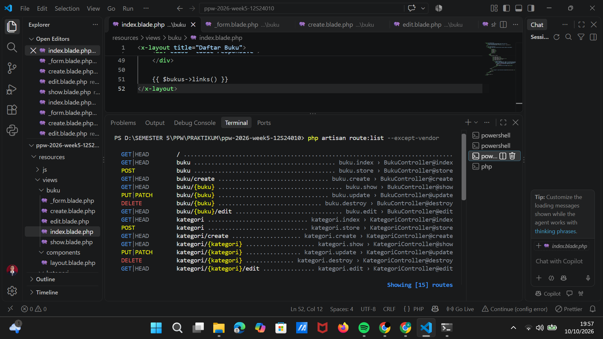

### 4.4 Implicit Route Model Binding

Parameter `{buku}` dan `{kategori}` pada URL dicocokkan dengan type-hint pada method controller, sehingga Laravel otomatis mengambil record dari database (dan menghasilkan 404 jika tidak ditemukan) tanpa `Buku::find($id)` manual:

```php
public function show(Buku $buku)      // GET /buku/10  -> Buku dengan id 10
public function edit(Buku $buku)
public function update(Request $request, Buku $buku)
public function destroy(Buku $buku)
```

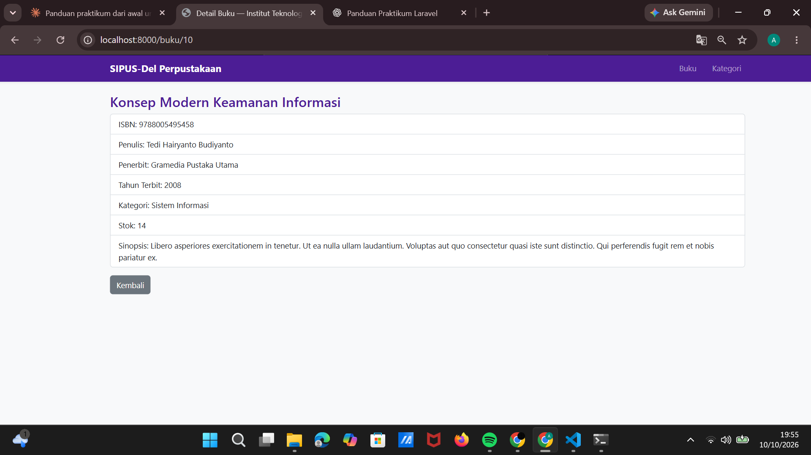

## 5. Model Relasional dan Eloquent ORM

### 5.1 Skema data (Migrations)

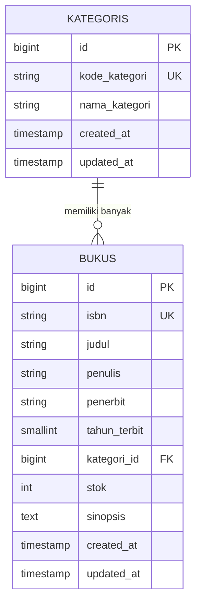

| Tabel | Kolom | Tipe dan constraint |
|---|---|---|
| `kategoris` | `kode_kategori` | `string(10)`, **unique** |
| | `nama_kategori` | `string(100)` |
| `bukus` | `isbn` | `string(17)`, **unique** |
| | `judul` | `string(200)`, **index** (mempercepat pencarian judul) |
| | `penulis`, `penerbit` | `string(150)` |
| | `tahun_terbit` | `unsignedSmallInteger` |
| | `kategori_id` | `foreignId` ke `kategoris.id`, `restrictOnDelete()` |
| | `stok` | `unsignedInteger`, default `0` (tidak bisa negatif) |
| | `sinopsis` | `text`, nullable |

Pilihan desain: `restrictOnDelete()` mencegah kategori yang masih memiliki buku terhapus sehingga buku tidak menjadi yatim (orphan). Tipe `unsigned` pada `stok` dan `tahun_terbit` menjadi lapisan pengaman kedua setelah validasi aplikasi.

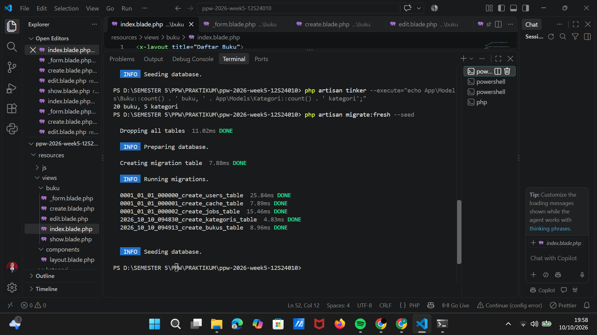

### 5.2 Model, relasi, dan mass assignment

```php
// app/Models/Kategori.php
protected $fillable = ['kode_kategori', 'nama_kategori'];
public function bukus(): HasMany { return $this->hasMany(Buku::class); }

// app/Models/Buku.php
protected $fillable = ['isbn', 'judul', 'penulis', 'penerbit',
                       'tahun_terbit', 'kategori_id', 'stok', 'sinopsis'];
public function kategori(): BelongsTo { return $this->belongsTo(Kategori::class); }
```

`$fillable` hanya mengizinkan kolom yang terdaftar untuk diisi lewat `create()` / `update()`, sehingga kolom lain (misalnya `id`) tidak bisa disisipkan lewat request (proteksi Mass Assignment).

### 5.3 Mitigasi N+1 Query

| Lokasi | Teknik |
|---|---|
| `BukuController@index` | `Buku::with('kategori')->latest()->paginate(10)` (Eager Loading) |
| `KategoriController@index` | `Kategori::withCount('bukus')` (agregasi dalam satu kueri) |
| `BukuController@show`, `KategoriController@show` | `load('kategori')` / `load('bukus')` |

Bukti terukur ada di [bagian 8.3](#83-bukti-audit-kueri-sql-eager-loading-vs-n1).

## 6. Validasi Input dan Keamanan Web

### 6.1 Aturan validasi server-side (`$request->validate()`)

**Buku** (`BukuController::rules()`, dipakai bersama oleh `store` dan `update`):

| Field | Aturan |
|---|---|
| `isbn` | `required`, `string`, `max:17`, **`unique:bukus,isbn`** (saat update, record yang sedang diedit dikecualikan dengan `Rule::unique(...)->ignore($buku->id)`) |
| `judul` | `required`, `string`, **`min:5`**, `max:200` |
| `penulis`, `penerbit` | `required`, `string`, `max:150` |
| `tahun_terbit` | `required`, `integer`, `between:1900,<tahun berjalan>` |
| `kategori_id` | `required`, `exists:kategoris,id` |
| `stok` | `required`, `integer`, **`min:0`** |
| `sinopsis` | `nullable`, `string` |

**Kategori:** `kode_kategori` (`required`, `max:10`, `unique`) dan `nama_kategori` (`required`, `min:3`, `max:100`).

Jika validasi gagal, Laravel mengembalikan pengguna ke form dengan pesan galat per kolom dan mempertahankan isian sebelumnya lewat `old()`.

| Form kosong | Aturan spesifik (ISBN duplikat, judul < 5, stok negatif) |
|---|---|
| 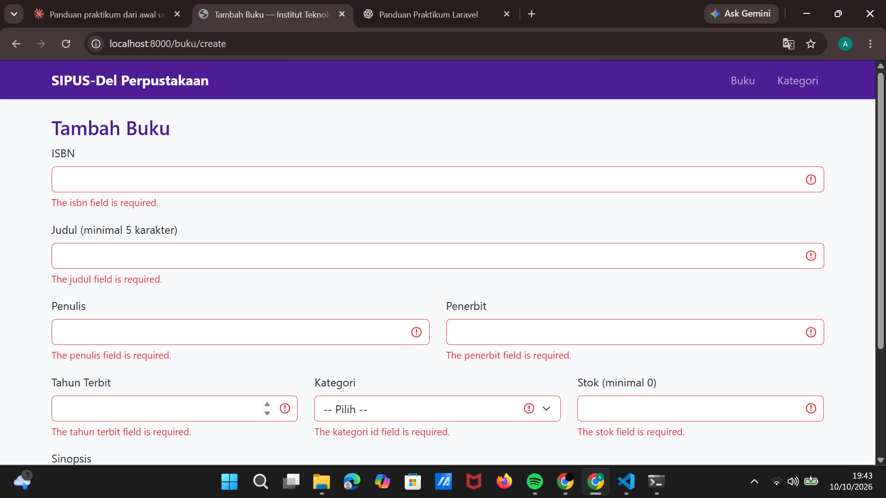 | 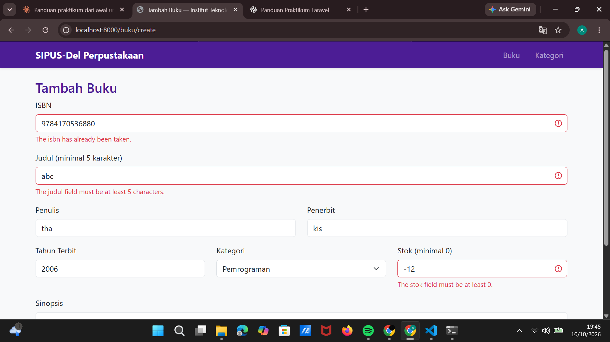 |

### 6.2 Lapisan keamanan

| Ancaman | Perlindungan |
|---|---|
| **CSRF** | Semua form `POST`/`PUT`/`DELETE` menyertakan `@csrf`; middleware Laravel memverifikasi token (tanpa token, respons `419 Page Expired`). |
| **Method spoofing** | Browser hanya mengirim GET/POST, sehingga form edit memakai `@method('PUT')` dan form hapus memakai `@method('DELETE')`. |
| **XSS** | Seluruh output memakai `{{ }}` yang otomatis di-escape oleh Blade. Tidak ada `{!! !!}`. |
| **SQL Injection** | Seluruh akses data lewat Eloquent / Query Builder dengan parameter binding, tanpa SQL mentah. |
| **Mass Assignment** | Properti `$fillable` pada kedua model, dan `create()`/`update()` hanya menerima array hasil `validate()`. |
| **Integritas data** | `exists:kategoris,id` pada validasi, foreign key di database, dan `restrictOnDelete()`. |
| **Kerahasiaan konfigurasi** | `.env` dan `vendor/` tidak di-commit (terdaftar di `.gitignore`); disediakan `.env.example` tanpa `APP_KEY`. |

## 7. Blade Templating dan Desain UI

- **Master layout** `resources/views/components/layout.blade.php` dipakai sebagai Blade Component `<x-layout title="...">` oleh semua halaman. Isi halaman dimasukkan lewat `{{ $slot }}` sehingga tidak ada duplikasi navbar atau `<head>` di tiap view.
- **Tema Del Royal Purple** (`#4C1D95`) untuk navbar, judul, dan tombol utama (`.btn-del`, hover `#3B0764`), dibangun di atas Bootstrap 5.3.
- **Flash message**: `session('success')` (kotak hijau) dan `session('error')` (kotak merah) ditampilkan di layout dan dapat ditutup.
- **Pagination aktif**: `paginate(10)` dengan `Paginator::useBootstrapFive()` di `AppServiceProvider`.
- **Data kosong**: `@forelse ... @empty ... @endforelse` pada tabel buku dan kategori.
- **Form DRY**: `_form.blade.php` dipakai bersama oleh halaman tambah dan edit (`@include`), menampilkan galat dengan `@error`.

| Struktur view | |
|---|---|
| `components/layout.blade.php` | Master shell |
| `buku/` | `index`, `create`, `edit`, `show`, `_form` |
| `kategori/` | `index`, `create`, `edit`, `show`, `_form` |

**Tampilan aplikasi**

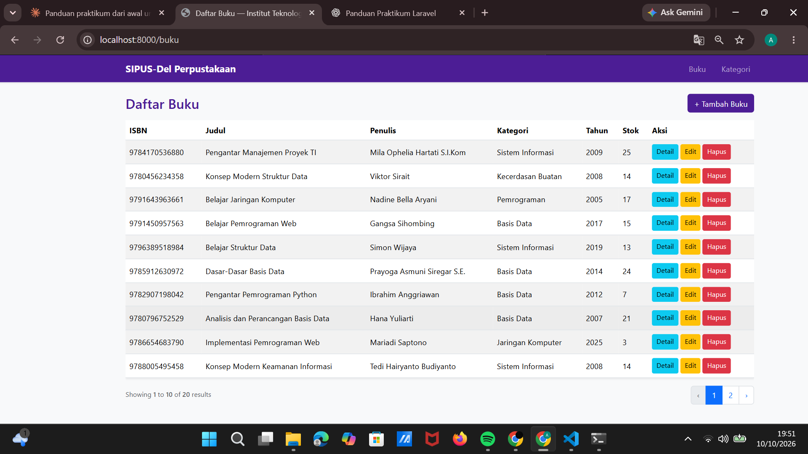

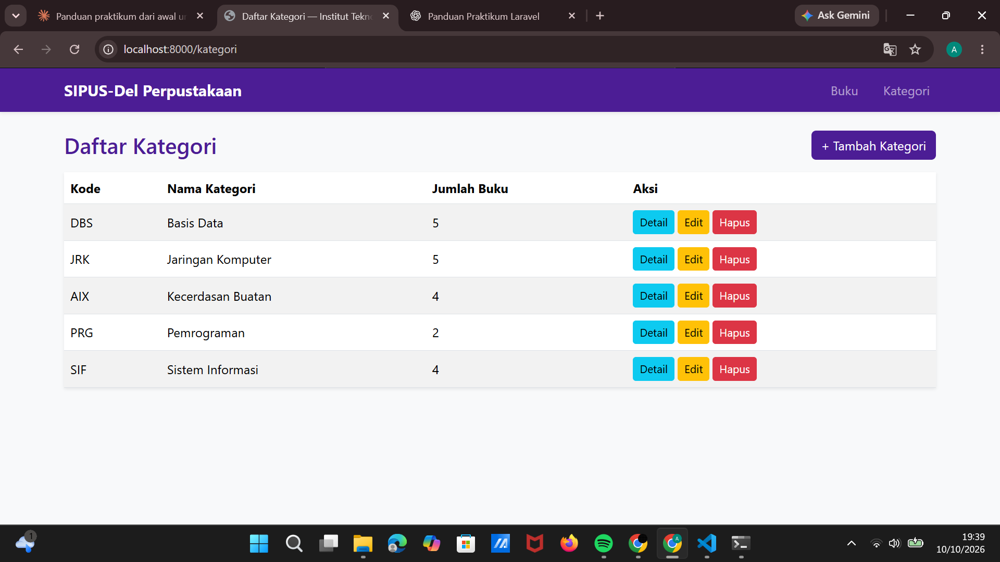

| Flash sukses setelah tambah buku | Flash galat saat hapus kategori yang masih berisi buku |
|---|---|
| 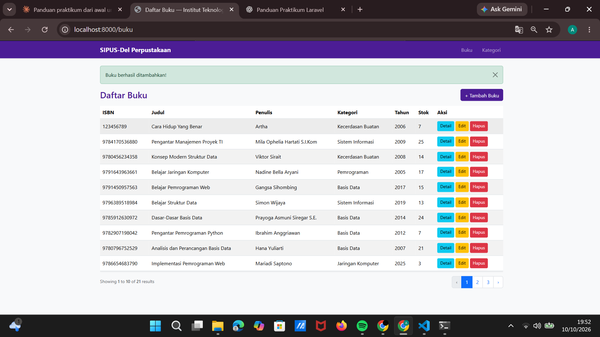 | 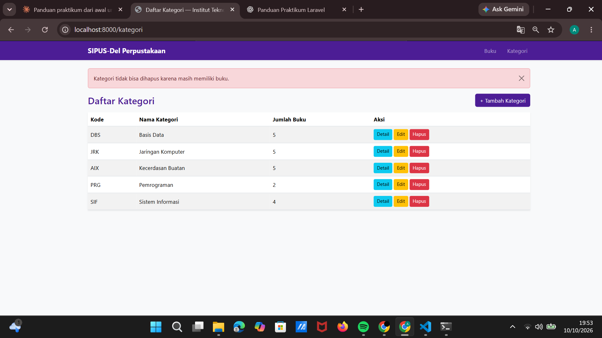 |

| Pagination halaman 2 | Form edit (terisi data lama) |
|---|---|
| 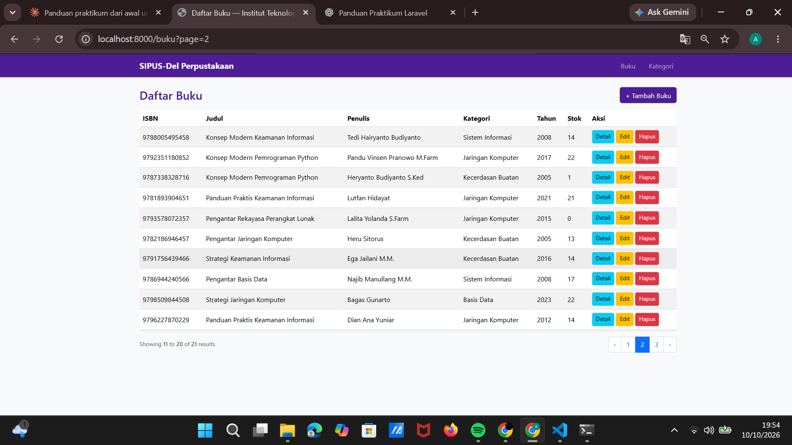 | 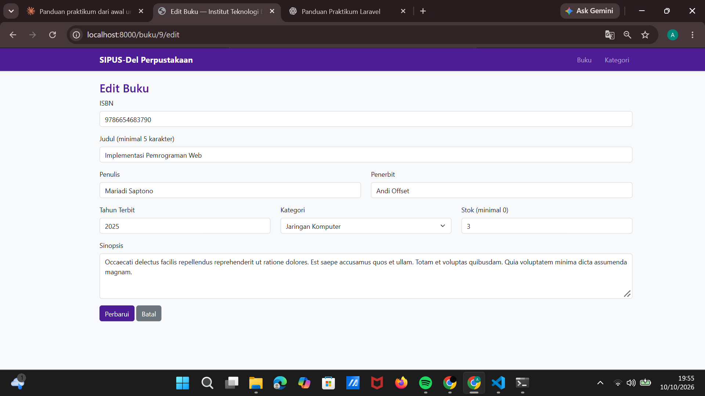 |

Catatan: screenshot flash sukses dan halaman 2 diambil setelah satu buku ditambahkan lewat form, sehingga total tertulis 21 buku. Data seeder awal berjumlah 20 buku.

## 8. Seeder, Factory, dan Audit Kueri SQL

### 8.1 Seeder dan Factory

- `DatabaseSeeder` membuat **5 kategori** tetap (PRG Pemrograman, DBS Basis Data, JRK Jaringan Komputer, SIF Sistem Informasi, AIX Kecerdasan Buatan), lalu memanggil `Buku::factory(20)->create()`.
- `BukuFactory` membangkitkan data realistis dengan Faker: ISBN-13 unik, judul dari kombinasi awalan dan topik informatika, penulis bernama Indonesia (`APP_FAKER_LOCALE=id_ID`), penerbit dari daftar penerbit nyata, tahun 2005 sampai 2025, stok 0 sampai 25, dan sinopsis acak.
- `KategoriFactory` tersedia untuk pembuatan kategori tambahan.

```bash
php artisan migrate:fresh --seed
php artisan tinker --execute="echo App\Models\Buku::count().' buku, '.App\Models\Kategori::count().' kategori';"
# 20 buku, 5 kategori
```

### 8.2 Listener audit SQL

Pada `AppServiceProvider::boot()`:

```php
DB::listen(function ($query) {
    Log::info(sprintf("[SQL AUDIT] (%.2f ms) %s", $query->time, $query->sql));
});
```

Setiap kueri dicatat ke `storage/logs/laravel.log` (`LOG_STACK=single`, `LOG_LEVEL=debug`). Kueri ke tabel `sessions` berasal dari driver session database Laravel 11 dan bukan bagian dari data buku.

### 8.3 Bukti audit kueri SQL: Eager Loading vs N+1

Prosedur: log dikosongkan, halaman `/buku` dibuka, lalu log dihitung.

```powershell
Set-Content storage\logs\laravel.log ""
Select-String 'SQL AUDIT' storage\logs\laravel.log | ForEach-Object { $_.Line } | Out-File docs\bukti-eager-loading.txt
(Select-String 'from "kategoris"' storage\logs\laravel.log).Count
```

| Kondisi | Kode di `index()` | Kueri ke tabel `kategoris` | Berkas log |
|---|---|---|---|
| **Dengan Eager Loading** | `Buku::with('kategori')->latest()->paginate(10)` | **1** kueri (`where "id" in (...)`) | [docs/bukti-eager-loading.txt](docs/bukti-eager-loading.txt) |
| **Tanpa Eager Loading** (N+1) | `Buku::latest()->paginate(10)` | **20** kueri tercatat (halaman dimuat dua kali, masing-masing 10 kueri untuk 10 baris) | [docs/bukti-tanpa-eager-loading.txt](docs/bukti-tanpa-eager-loading.txt) |

Kueri data pada kondisi **dengan Eager Loading** (3 kueri, tetap 3 berapa pun jumlah barisnya):

```
[SQL AUDIT] (0.13 ms) select count(*) as aggregate from "bukus"
[SQL AUDIT] (0.14 ms) select * from "bukus" order by "created_at" desc limit 10 offset 0
[SQL AUDIT] (0.15 ms) select * from "kategoris" where "kategoris"."id" in (1, 2, 3, 4, 5)
```

Penjelasan: `paginate()` selalu menambah satu kueri `count(*)` untuk menghitung total halaman, sehingga totalnya 3 kueri (bukan 2 seperti pada contoh teori modul). Yang penting, jumlah kueri **konstan**. Tanpa Eager Loading, setiap baris memicu satu kueri `select * from "kategoris" where "id" = ? limit 1` (Lazy Loading), sehingga kueri bertambah sebanding dengan jumlah baris (N+1).

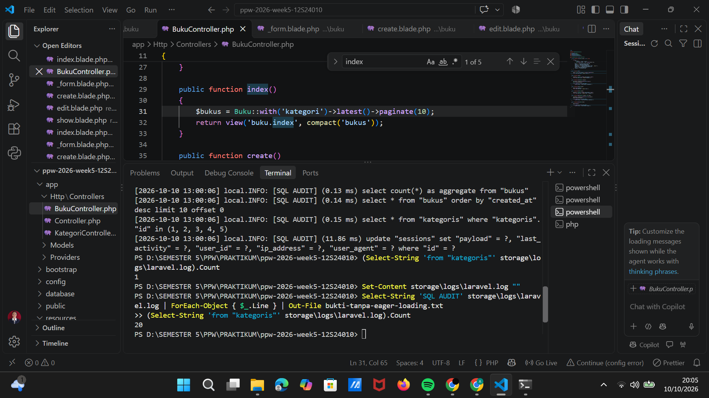

## 9. Riwayat Git

Repositori memakai **Conventional Commits** dengan commit bertahap per lapisan:

| Commit | Isi |
|---|---|
| `chore: initialize laravel 11 project` | Kerangka proyek |
| `feat(migration): create kategoris and bukus tables schema` | Skema data |
| `feat(model): define relationships and fillable attributes` | Model dan relasi |
| `feat(seeder): add factories and seeders for 5 kategori and 20 buku` | Factory dan seeder |
| `feat(controller): implement restful actions and server validation` | Routes dan controller |
| `feat(views): construct blade component layout and crud templates` | Layout dan view |
| `perf(eager-loading): optimize sql queries to prevent n+1 problem` | Eager Loading dan audit SQL |
| `docs: add readme, screenshots and sql audit evidence` | Dokumentasi |

Lihat riwayat lengkap dengan `git log --oneline`.

 Berkas `.env` dan folder `vendor/` tidak pernah di-commit.

## 10. Kesesuaian dengan Spesifikasi Tugas

| Persyaratan | Pemenuhan | Bagian |
|---|---|---|
| Skema `kategoris` dan `bukus` dengan tipe data dan index presisi | Unique pada ISBN dan kode, index pada judul, foreign key, tipe unsigned | [5.1](#51-skema-data-migrations) |
| Relasi `hasMany` / `belongsTo`, `$fillable`, Eager Loading di semua index | Kedua model, `with('kategori')` dan `withCount('bukus')` | [5.2](#52-model-relasi-dan-mass-assignment), [5.3](#53-mitigasi-n1-query) |
| `Route::resource` buku dan kategori, 7 method, Route Model Binding | 14 rute resource + 1 redirect | [4.3](#43-daftar-rute), [4.4](#44-implicit-route-model-binding) |
| Validasi ketat (ISBN unik, judul min 5, stok min 0), `@csrf`, method spoofing | `$request->validate()`, `@csrf`, `@method` | [6](#6-validasi-input-dan-keamanan-web) |
| Master layout `<x-layout>` Del Purple, pagination, flash, `@forelse` | Seluruhnya diterapkan | [7](#7-blade-templating-dan-desain-ui) |
| Seeder dan Factory (min. 5 kategori, 20 buku) dan log audit SQL | 5 kategori, 20 buku, log dengan dan tanpa Eager Loading | [8](#8-seeder-factory-dan-audit-kueri-sql) |
| `.env` tidak di-commit, `.env.example` valid | Terdaftar di `.gitignore`, `.env.example` disertakan | [6.2](#62-lapisan-keamanan) |

## 11. Catatan Teknis

- **Versi Laravel.** Modul mewajibkan Laravel 11.x. Proyek dibuat dengan `composer create-project laravel/laravel:^11.0 ... --no-security-blocking` karena Composer versi terbaru memblokir seluruh rilis Laravel 11.x akibat *security advisory* (Laravel 11 sudah melewati masa dukungan keamanan). Proyek ini hanya untuk keperluan pembelajaran di lingkungan lokal dan tidak dimaksudkan untuk dipublikasikan sebagai aplikasi produksi.
- **Pesan validasi** tampil dalam bahasa Inggris karena `APP_LOCALE=en` (Laravel 11 tidak menyertakan terjemahan bahasa Indonesia secara bawaan). Label form dan pesan flash memakai bahasa Indonesia.
- **Bootstrap** dimuat dari CDN (`cdn.jsdelivr.net`), sehingga tampilan membutuhkan koneksi internet.
- **Sesi dan cache** memakai driver `database` (bawaan Laravel 11), sehingga log audit juga memuat kueri ke tabel `sessions`.

---

Institut Teknologi Del, Fakultas Informatika dan Teknik Elektro. Dosen pengampu: Chandro Pardede, S.Kom., M.Sc.
