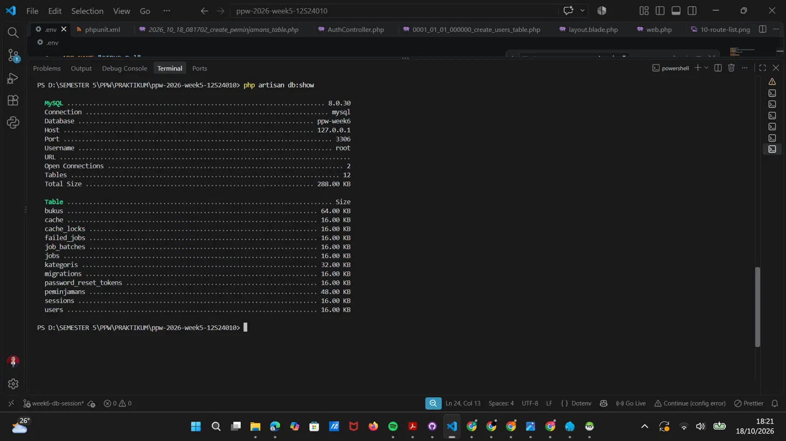
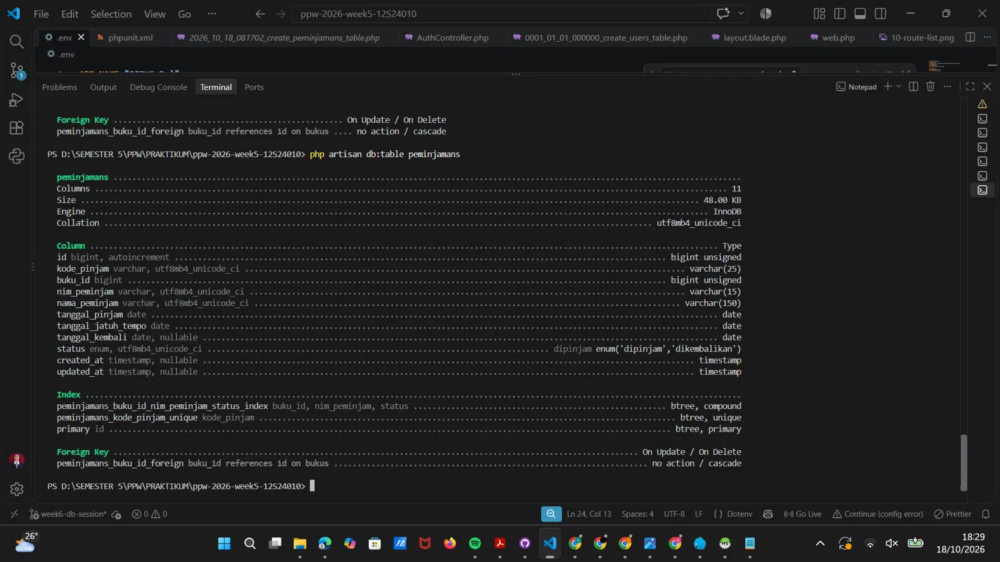
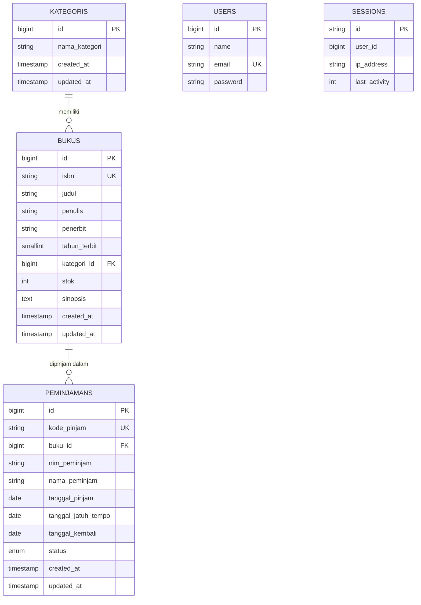
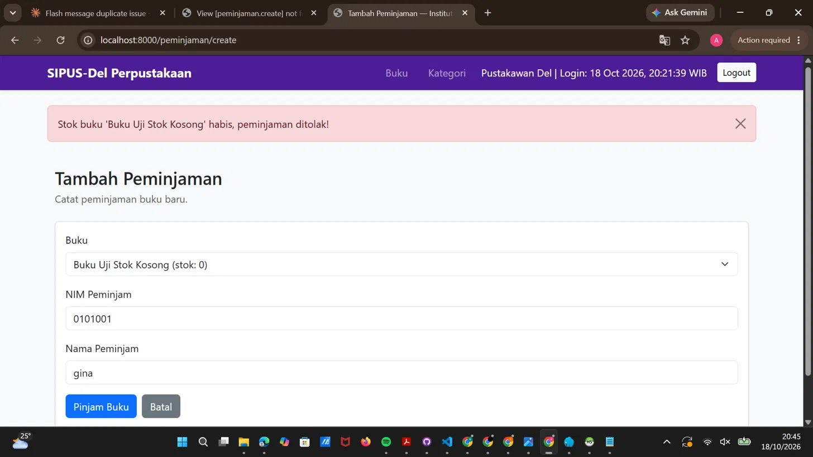
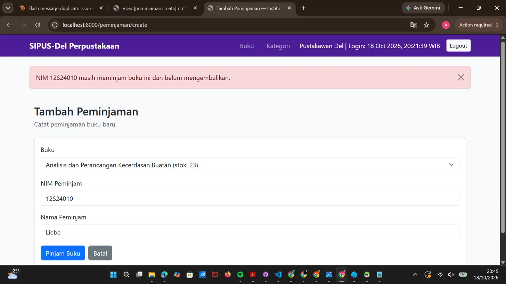
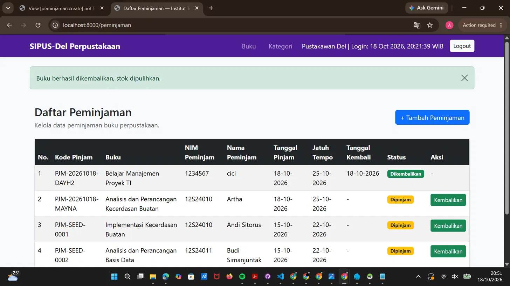
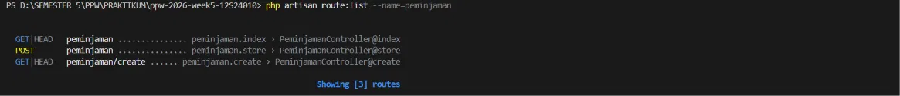
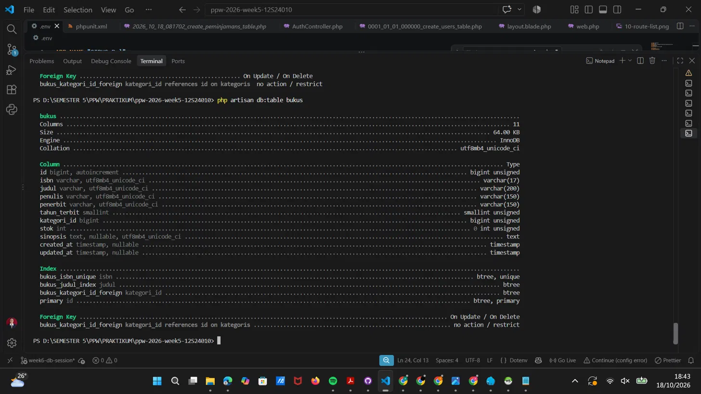
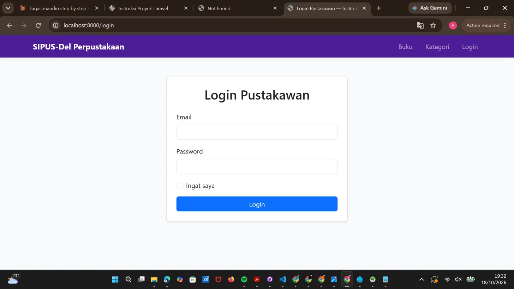

Readme · MD
# SIPUS-Del Tahap 2: Sistem Informasi Perpustakaan Kampus Del
 
Tugas Mandiri Minggu 6, Mata Kuliah **Pemrograman & Pengujian Web (12S3101)**, Institut Teknologi Del.
 
Pengembangan lanjutan SIPUS-Del (Minggu 5) dengan fokus pada konektivitas basis data MySQL, transaksi sirkulasi buku berbasis **ACID** (`DB::transaction` + `lockForUpdate`), rekapitulasi **Query Builder**, serta **manajemen sesi, cookie, dan autentikasi pustakawan** pada Laravel 11.
 
| | |
|---|---|
| **Nama** | Artha Liebe Siregar |
| **NIM** | 12S24010 |
| **Repositori** | https://github.com/Arthasiregar/ppw-2026-week5-12S24010/tree/week6-db-session |
| **Branch** | `week6-db-session` |
| **Stack** | PHP 8.4, Laravel 11.57, MySQL 8.0 (InnoDB), Bootstrap 5 |
 
---
 
## Daftar Isi
 
1. [Akun Uji Pustakawan](#1-akun-uji-pustakawan)
2. [Cara Menjalankan Proyek](#2-cara-menjalankan-proyek)
3. [Konektivitas Database dan Migrasi `peminjamans`](#3-konektivitas-database-dan-migrasi-peminjamans)
4. [ERD dan Relasi Eloquent](#4-erd-dan-relasi-eloquent)
5. [Transaksi ACID dan Concurrency Locking](#5-transaksi-acid-dan-concurrency-locking)
6. [Bukti Pengujian Transaksi ACID](#6-bukti-pengujian-transaksi-acid)
7. [Query Builder, withCount, dan Filter Dinamis](#7-query-builder-withcount-dan-filter-dinamis)
8. [Manajemen Sesi, Cookie, dan Autentikasi](#8-manajemen-sesi-cookie-dan-autentikasi)
9. [Audit Cookie dan Sesi](#9-audit-cookie-dan-sesi)
10. [Seeder](#10-seeder)
11. [Keamanan Repositori](#11-keamanan-repositori)
12. [Pemetaan terhadap Rubrik Penilaian](#12-pemetaan-terhadap-rubrik-penilaian)
 
---
 
## 1. Akun Uji Pustakawan
 
| Email | Password |
|---|---|
| `pustakawan@del.ac.id` | `password123` |
 
Akun dibuat otomatis oleh seeder. Semua rute mutasi (CRUD buku/kategori, peminjaman, pengembalian) hanya bisa diakses setelah login.
 
---
 
## 2. Cara Menjalankan Proyek
 
```bash
git clone [URL REPOSITORI]
cd [NAMA FOLDER REPOSITORI]
git checkout week6-db-session
 
composer install
cp .env.example .env
php artisan key:generate
```
 
Buat database kosong bernama `ppw-week6` di MySQL, lalu sesuaikan `.env`:
 
```env
DB_CONNECTION=mysql
DB_HOST=127.0.0.1
DB_PORT=3306
DB_DATABASE=ppw-week6
DB_USERNAME=root
DB_PASSWORD=
 
SESSION_DRIVER=database
APP_TIMEZONE=Asia/Jakarta
```
 
Jalankan migrasi, seeder, dan server:
 
```bash
php artisan migrate:fresh --seed
php artisan serve
```
 
Buka `http://localhost:8000`.
 
Verifikasi koneksi database:
 
```bash
php artisan db:show
```
 
---
 
## 3. Konektivitas Database dan Migrasi `peminjamans`
 
Aplikasi terhubung ke MySQL 8.0 melalui PDO. Konfigurasi koneksi dibaca dari `.env` (tidak ikut ke repositori) dan diverifikasi dengan `php artisan db:show`.
 
**Bukti koneksi dan daftar tabel (database `ppw-week6`, 12 tabel termasuk `bukus`, `kategoris`, `peminjamans`, `sessions`, `users`):**
 

 
### Migrasi tabel `peminjamans`
 
| Kolom | Tipe | Keterangan |
|---|---|---|
| `id` | bigint unsigned, PK | |
| `kode_pinjam` | varchar(25) | **unique** |
| `buku_id` | bigint unsigned | **FK ke `bukus.id`, `ON DELETE CASCADE`** |
| `nim_peminjam` | varchar(15) | |
| `nama_peminjam` | varchar(150) | |
| `tanggal_pinjam` | date | |
| `tanggal_jatuh_tempo` | date | |
| `tanggal_kembali` | date, nullable | diisi saat pengembalian |
| `status` | enum(`dipinjam`,`dikembalikan`) | default `dipinjam` |
| `created_at`, `updated_at` | timestamp | |
 
Indeks tambahan: composite index `(buku_id, nim_peminjam, status)` untuk mempercepat pemeriksaan "NIM yang sama masih meminjam buku yang sama".
 
**Struktur tabel `peminjamans` (kolom, indeks, dan foreign key `cascade`):**
 

 
**Struktur tabel `bukus` (referensi foreign key):**
 

 
---
 
## 4. ERD dan Relasi Eloquent
 

 
Catatan relasi:
 
- `bukus.kategori_id` merujuk `kategoris.id` dengan aksi `restrict` (kategori yang masih dipakai buku tidak bisa dihapus).
- `peminjamans.buku_id` merujuk `bukus.id` dengan aksi `cascade` (peminjaman ikut terhapus bila bukunya dihapus).
- `SESSIONS.user_id` terisi ketika pengguna login, dipakai oleh session driver `database`.
 
Relasi Eloquent:
 
```php
// app/Models/Peminjaman.php
public function buku(): BelongsTo
{
    return $this->belongsTo(Buku::class);
}
 
// app/Models/Buku.php
public function peminjamans(): HasMany
{
    return $this->hasMany(Peminjaman::class);
}
```
 
Model `Peminjaman` mendefinisikan `$fillable` untuk seluruh kolom input dan `$casts` bertipe `date` pada ketiga kolom tanggal.
 
---
 
## 5. Transaksi ACID dan Concurrency Locking
 
Operasi peminjaman dan pengembalian mengubah lebih dari satu tabel (`bukus` dan `peminjamans`), sehingga harus atomik. Seluruh proses dibungkus `DB::transaction()` (dengan 3 kali percobaan ulang bila terjadi deadlock) dan baris buku dikunci dengan `lockForUpdate()` (`SELECT ... FOR UPDATE`).
 
**Mengapa `lockForUpdate()` wajib?** Bila stok tinggal 1 dan dua pustakawan menekan tombol pinjam pada milidetik yang sama tanpa penguncian, keduanya bisa lolos pemeriksaan `stok > 0` sehingga stok menjadi -1 (race condition). Dengan `lockForUpdate()`, transaksi kedua mengantre sampai transaksi pertama selesai, lalu membaca stok terbaru (0) dan ditolak.
 
### Peminjaman buku (`PeminjamanController@store`)
 
```php
DB::transaction(function () use ($validated) {
    $buku = Buku::where('id', $validated['buku_id'])
        ->lockForUpdate()
        ->firstOrFail();
 
    if ($buku->stok < 1) {
        throw new \RuntimeException("Stok buku '{$buku->judul}' habis, peminjaman ditolak!");
    }
 
    $nim = strtoupper(trim($validated['nim_peminjam']));
 
    $sudahPinjam = Peminjaman::where('buku_id', $buku->id)
        ->where('nim_peminjam', $nim)
        ->where('status', 'dipinjam')
        ->exists();
 
    if ($sudahPinjam) {
        throw new \RuntimeException("NIM {$nim} masih meminjam buku ini dan belum mengembalikan.");
    }
 
    $buku->decrement('stok');
 
    Peminjaman::create([
        'kode_pinjam'         => 'PJM-' . now()->format('Ymd') . '-' . strtoupper(Str::random(5)),
        'buku_id'             => $buku->id,
        'nim_peminjam'        => $nim,
        'nama_peminjam'       => $validated['nama_peminjam'],
        'tanggal_pinjam'      => now()->toDateString(),
        'tanggal_jatuh_tempo' => now()->addDays(7)->toDateString(),
        'status'              => 'dipinjam',
    ]);
}, 3);
```
 
### Pengembalian buku (`PeminjamanController@kembali`)
 
```php
DB::transaction(function () use ($id) {
    $pinjam = Peminjaman::where('id', $id)->lockForUpdate()->firstOrFail();
 
    if ($pinjam->status === 'dikembalikan') {
        throw new \RuntimeException('Buku ini sudah dikembalikan sebelumnya.');
    }
 
    $buku = Buku::where('id', $pinjam->buku_id)->lockForUpdate()->firstOrFail();
 
    $pinjam->update([
        'status'          => 'dikembalikan',
        'tanggal_kembali' => now()->toDateString(),
    ]);
    $buku->increment('stok');
}, 3);
```
 
### Penanganan error
 
| Jenis error | Penanganan |
|---|---|
| `RuntimeException` (stok habis, peminjaman ganda, sudah dikembalikan) | Transaksi di-**rollback**, pesan error ditampilkan lewat flash session |
| `QueryException` (kesalahan database) | Dicatat dengan `Log::error('[DB EXCEPTION]...')` ke `storage/logs/laravel.log`, pengguna menerima pesan umum |
 
---
 
## 6. Bukti Pengujian Transaksi ACID
 
Pengujian dilakukan setelah `php artisan migrate:fresh --seed`, dengan akun `pustakawan@del.ac.id`. Setiap uji dibuktikan dengan **query stok di terminal sebelum dan sesudah** aksi:
 
```bash
php artisan tinker --execute="dump(App\Models\Buku::whereIn('judul',['Analisis dan Perancangan Kecerdasan Buatan','Buku Uji Stok Kosong','Buku Uji Stok Satu'])->get(['id','judul','stok'])->toArray(), App\Models\Peminjaman::count());"
```
 
| No | Skenario | Hasil yang diharapkan | Bukti |
|---|---|---|---|
| 1 | Pinjam buku dengan stok > 1 | Stok berkurang 1, baris peminjaman baru berstatus `dipinjam` | SS-15, SS-16 |
| 2 | Pinjam buku dengan stok 0 | Ditolak, **rollback**, stok tetap 0 dan tidak ada baris baru | SS-17, SS-18 |
| 3 | NIM yang sama meminjam buku yang sama | Ditolak | SS-19 |
| 4 | Buku stok 1 dipinjam dua NIM berbeda | Peminjam pertama berhasil (stok 0), kedua ditolak, stok tidak minus | SS-20a, SS-20b |
| 5 | Pengembalian buku | Status `dikembalikan`, `tanggal_kembali` terisi, stok bertambah 1 | SS-21, SS-22 |
 
### 6.1 Peminjaman berhasil
 
Stok buku berkurang tepat 1 dan jumlah baris `peminjamans` bertambah 1 (terminal, sebelum dan sesudah):
 

 
Halaman daftar peminjaman menampilkan flash sukses dan baris baru berstatus **Dipinjam**:
 

 
### 6.2 Penolakan stok 0 dan rollback
 
Peminjaman "Buku Uji Stok Kosong" ditolak dengan pesan error:
 

 
Query stok membuktikan rollback: stok tetap 0 (tidak minus) dan jumlah baris `peminjamans` tidak berubah:
 

 
### 6.3 Pencegahan peminjaman ganda
 
NIM yang masih meminjam buku yang sama ditolak:
 

 
### 6.4 Stok = 1 (stok tidak boleh minus)
 
Peminjam kedua pada buku bersisa 1 ditolak:
 

 
Stok berubah dari 1 menjadi 0 (bukan -1):
 

 
### 6.5 Pengembalian buku
 
Status berubah menjadi **Dikembalikan**, tanggal kembali terisi, dan flash sukses tampil:
 

 
Stok buku bertambah 1 setelah pengembalian (terminal, sebelum dan sesudah):
 

 
---
 
## 7. Query Builder, withCount, dan Filter Dinamis
 
Katalog buku (`BukuController@index`) memakai tiga pendekatan query Laravel:
 
1. **Eloquent + `withCount`**: menghitung jumlah peminjaman per buku dalam satu query (bebas N+1), dengan `with('kategori')` untuk eager loading kategori.
2. **`when()`**: filter pencarian dinamis (judul/penulis/ISBN) dan kategori, hanya diterapkan bila parameter ada. Kondisi `orWhere` dikelompokkan dalam closure agar tidak merusak filter kategori.
3. **Fluent Query Builder `DB::table()`**: kartu statistik perpustakaan.
 
```php
$bukus = Buku::with('kategori')
    ->withCount('peminjamans')
    ->when($request->search, function ($query, $search) {
        $query->where(function ($q) use ($search) {
            $q->where('judul', 'like', "%{$search}%")
              ->orWhere('penulis', 'like', "%{$search}%")
              ->orWhere('isbn', 'like', "%{$search}%");
        });
    })
    ->when($request->kategori_id, fn ($query, $id) => $query->where('kategori_id', $id))
    ->orderBy('judul')
    ->paginate(10)
    ->withQueryString();
 
$stats = [
    'total_judul'        => DB::table('bukus')->count(),
    'total_stok'         => DB::table('bukus')->sum('stok'),
    'total_dipinjam'     => DB::table('peminjamans')->where('status', 'dipinjam')->count(),
    'total_dikembalikan' => DB::table('peminjamans')->where('status', 'dikembalikan')->count(),
];
```
 
Riwayat pencarian terakhir disimpan di Session (`last_search`) dan ditampilkan di halaman katalog.
 
### 7.1 Kartu statistik dan kolom jumlah peminjaman
 
Empat kartu statistik (Total Judul, Total Stok Tersedia, Total Sedang Dipinjam, Total Dikembalikan) dan kolom **Jumlah Dipinjam** dari `withCount('peminjamans')`:
 

 
### 7.2 Pencarian dan filter kategori
 
Kata kunci dan kategori tersimpan di URL, riwayat pencarian terakhir tampil dari Session:
 

 
### 7.3 Paginasi dengan `withQueryString()`
 
Pada halaman 2, parameter pencarian tetap terbawa di URL:
 

 
---
 
## 8. Manajemen Sesi, Cookie, dan Autentikasi
 
### Konfigurasi
 
- `SESSION_DRIVER=database`: payload sesi disimpan di tabel `sessions` (sisi server), browser hanya menerima Session ID terenkripsi lewat cookie `sipus_del_session`.
- Login memakai `Auth::attempt()` dengan opsi "Ingat saya".
- Saat login: `session()->regenerate()` (mencegah **Session Fixation**).
- Saat logout: `Auth::logout()`, `session()->invalidate()`, dan `session()->regenerateToken()`.
- State sesi: `login_timestamp` (waktu login, tampil di navbar), `last_search` (pencarian katalog terakhir), dan `last_borrower` (NIM peminjam terakhir).
- Cookie: `del_last_user_email` dibuat dengan `Cookie::queue()` (masa berlaku 7 hari).
 
```php
public function login(Request $request)
{
    $credentials = $request->validate([
        'email'    => 'required|email',
        'password' => 'required|string',
    ]);
 
    if (Auth::attempt($credentials, $request->boolean('remember'))) {
        $request->session()->regenerate();   // anti Session Fixation
        session(['login_timestamp' => now()->format('d M Y, H:i:s') . ' WIB']);
        Cookie::queue('del_last_user_email', $request->email, 10080);
 
        return redirect()->intended(route('buku.index'))->with('success', 'Login berhasil.');
    }
 
    return back()->withInput($request->only('email'))->with('error', 'Kredensial login tidak valid.');
}
 
public function logout(Request $request)
{
    Auth::logout();
    $request->session()->invalidate();
    $request->session()->regenerateToken();
 
    return redirect()->route('login')->with('success', 'Sesi server telah dihapus dengan aman.');
}
```
 
### Proteksi rute dengan middleware `auth`
 
Rute **publik** (hanya membaca): `buku.index`, `buku.show`, `kategori.index`, `kategori.show`, dan halaman login.
Rute **terproteksi `auth`**: create/store/edit/update/destroy buku dan kategori, seluruh rute peminjaman, dan logout.
 
Daftar rute peminjaman beserta middleware (`auth` tampil pada semua rute):
 

 
Daftar rute buku (`create`, `store`, `edit`, `update`, `destroy` memakai `auth`; `index` dan `show` publik):
 

 
### Alur autentikasi
 
**Halaman login:**
 

 
**Login gagal** menampilkan pesan error:
 

 
**Akses rute terproteksi tanpa login** (`/peminjaman`) dialihkan ke `/login`:
 

 
**Login berhasil**: navbar menampilkan nama pustakawan, waktu login dari Session (`login_timestamp`), tombol Logout, dan flash message:
 

 
**Logout** menghapus sesi server dan kembali ke halaman login dengan flash message:
 

 
---
 
## 9. Audit Cookie dan Sesi
 
Inspeksi dilakukan pada Chrome DevTools, tab **Application, Cookies, `http://localhost:8000`**. Nilai cookie disamarkan.
 
| Cookie | HttpOnly | SameSite | Keterangan |
|---|---|---|---|
| `sipus_del_session` | ✔ | Lax | Session ID terenkripsi; **HttpOnly** mencegah pencurian cookie lewat JavaScript (XSS), **SameSite=Lax** memitigasi CSRF |
| `del_last_user_email` | ✔ | Lax | Dibuat dengan `Cookie::queue()`, berlaku 7 hari, terenkripsi oleh middleware cookie Laravel |
| `XSRF-TOKEN` | tidak | Lax | Token CSRF; sengaja tidak HttpOnly agar dapat dibaca JavaScript untuk request AJAX |
 
**Cookie sesi dengan flag HttpOnly dan SameSite=Lax:**
 

 
**Cookie `del_last_user_email` (dibuat dengan `Cookie::queue()`):**
 

 
**Payload sesi disimpan di sisi server, tabel `sessions` berisi sesi dengan `user_id` terisi (pengguna sudah login):**
 

 
---
 
## 10. Seeder
 
`php artisan migrate:fresh --seed` menjalankan seeder berikut:
 
| Seeder | Isi |
|---|---|
| `UserSeeder` | Akun pustakawan uji `pustakawan@del.ac.id` / `password123` |
| `BukuUjiSeeder` | Sampel buku, termasuk **"Buku Uji Stok Kosong" (stok 0)** dan **"Buku Uji Stok Satu" (stok 1)** untuk pengujian transaksi |
| `PeminjamanSeeder` | Sampel transaksi: `PJM-SEED-0001` dan `PJM-SEED-0002` berstatus dipinjam, `PJM-SEED-0003` berstatus dikembalikan |
 
**Output `migrate:fresh --seed` tanpa error:**
 

 
---
 
## 11. Keamanan Repositori
 
- `.env` dan folder `vendor/` **tidak** di-commit (terdaftar di `.gitignore`).
- Kredensial akun uji hanya berlaku untuk data seeder lokal (lihat bagian 1).
- Nilai cookie sesi pada screenshot disamarkan.
 
Bukti `.env` dan `vendor/` diabaikan Git:
 

 
Riwayat commit (Conventional Commits):
 

 
---
 
## 12. Pemetaan terhadap Rubrik Penilaian
 
| Kriteria (bobot) | Implementasi | Bukti |
|---|---|---|
| **1. Konektivitas DB dan migrasi `peminjamans` (20%)** | Koneksi MySQL via `.env`, diverifikasi `db:show`. Migrasi `peminjamans` dengan FK `buku_id` `cascadeOnDelete`, `kode_pinjam` unik, relasi `Buku` hasMany `Peminjaman` dan `Peminjaman` belongsTo `Buku` | Bagian 3 dan 4; SS-01, SS-02a, SS-02b |
| **2. Transaksi ACID dan Concurrency Locking (25%)** | Pinjam dan kembali dibungkus `DB::transaction()` + `lockForUpdate()`; stok 0 ditolak dan di-rollback; cegah NIM ganda; `QueryException` dicatat `Log::error()` | Bagian 5 dan 6; SS-15 sampai SS-22 |
| **3. Query Builder, withCount, dan filter (15%)** | Statistik `DB::table()`; katalog `with('kategori')->withCount('peminjamans')` (bebas N+1); filter `when()`; `paginate()->withQueryString()` | Bagian 7; SS-04, SS-05a, SS-05b |
| **4. Sesi, cookie, dan auth (25%)** | `Auth::attempt()`, `regenerate()` saat login, `invalidate()` + `regenerateToken()` saat logout; rute mutasi diproteksi `auth`; Session (`login_timestamp`, `last_search`, `last_borrower`) dan Cookie (`del_last_user_email`) | Bagian 8 dan 9; SS-03a, SS-03b, SS-06 sampai SS-13 |
| **5. Seeder, bukti uji ACID, dan dokumentasi (15%)** | Seeder akun pustakawan, buku stok 0 dan 1, dan sampel peminjaman; README memuat ERD, bukti rollback stok 0, dan audit cookie HttpOnly | Bagian 1, 4, 6, 9, 10; SS-14, SS-17, SS-18, SS-11 |
 
---
 
*Disusun untuk Mata Kuliah Pemrograman dan Pengujian Aplikasi Web (12S3101), Institut Teknologi Del, Semester Ganjil 2026/2027.*
 
Claude finished the response
